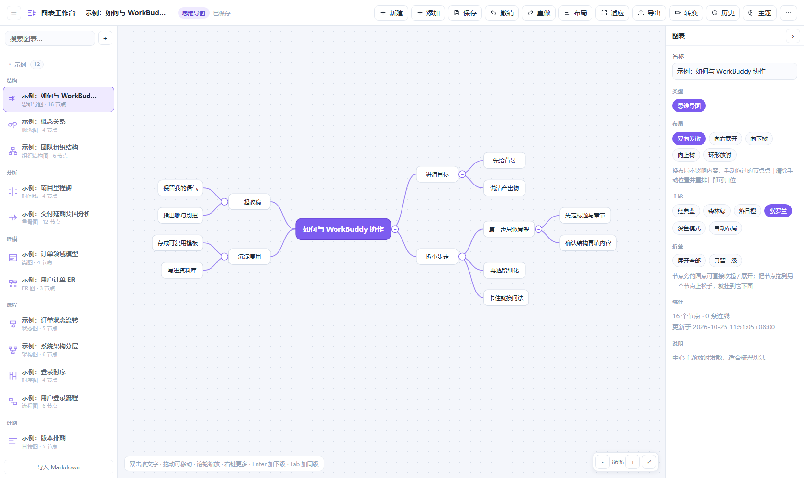

# 图表工作台（Chart Studio）

> **在线试用**：https://chart-workbench.app.workbuddy.host/?sharecode=D3JE443IGB
> —— 纯静态版，打开即用，改动存在浏览器本地（换设备看到的是初始示例）。

一个本地运行的**多类型图表工具**：**12 种图表装进同一个页面**，左侧选文件、中间画布、右侧属性，  
新建时挑类型即可，画图过程中**不需要在页面之间来回切换**。

最大的特点仍然是**数据就是文件**：所有图表都是 `charts/*.chart.json`，AI 助手可以直接读写、  
批量生成、二次加工，你在浏览器里的改动也能立刻被读到。



## 12 种图表，一个工作台

| 分组 | 类型    | 适合画什么               |
| -- | ----- | ------------------- |
| 结构 | 思维导图  | 中心主题放射发散，梳理想法       |
| 结构 | 组织结构图 | 部门/汇报线，自上而下         |
| 结构 | 概念图   | 自由节点 + 关系标签，想到哪画到哪  |
| 流程 | 流程图   | 步骤、判断、是/否分支（可回环）    |
| 流程 | 架构图   | 分层模块、外部系统、依赖关系      |
| 流程 | 时序图   | 参与者之间的消息往来顺序        |
| 流程 | 状态图   | 状态与迁移条件，含开始/结束      |
| 建模 | 类图    | 类、属性方法、继承/实现/组合     |
| 建模 | ER 图  | 实体、属性、1:N 基数关系      |
| 分析 | 鱼骨图   | 要因分析：问题 → 大类 → 具体原因 |
| 分析 | 时间线   | 按时间顺序展示里程碑          |
| 计划 | 甘特图   | 任务排期、负责人、进度百分比      |

一张图就是一份 JSON：**AI 直接写文件，界面里打开就能改**，改完 AI 接着读；  
同一份内容也能导出 Markdown / Mermaid / SVG / PNG / JSON，图片可选**透明底**（贴进 PPT / 深色背景不用再抠图）。

思维导图是打磨得最深的一种：**5 种排布**（双向发散 / 向右 / 向下 / 向上 / 环形）、  
**节点可折叠**、**拖到别的节点上就能换父级**、**纯图片节点铺满显示**、**批量拖入粘贴图片**，  
而且你手动排好的兄弟顺序**不会被自动布局打回原形**。

```
.
├── server.py                 本地服务：静态托管 + REST API（默认 127.0.0.1:8712），只用 Python 标准库
├── start.bat                 双击启动（Windows）
├── start.sh                  启动脚本（macOS / Linux）
├── studio/                   ★ 唯一前端：统一图表工作台（/studio/）
│   ├── index.html            三栏布局：文件列表 / 画布 / 属性面板
│   ├── styles.css            4 套配色 + 深色模式 + 响应式断点
│   ├── kinds.js              12 种图表的模板 + 布局算法 + 绘制 + 互转
│   ├── app.js                编辑引擎：选中/拖拽/就地编辑/连线/撤销/导出/图片
│   └── favicon.svg / png / ico   标签页、Windows 标题栏、iOS 主屏图标
├── web/
│   └── api-shim.js           静态演示版的「假后端」：用 localStorage 顶替 /api/charts
├── charts/                   图表数据 *.chart.json   ← 打开就能改的目录
│   ├── 示例：*.chart.json     12 张示例（只读保护，可 ↺ 重置）
│   ├── .history/             每次保存自动留快照（最多 30 份/图表，本地生成，不入库）
│   └── .samples/             示例底稿（点 ↺ 重置时用，本地生成，不入库）
├── tools/
│   ├── seed_charts.js        生成 12 种示例（同时校验布局）
│   ├── kinds.test.js         类型库单元测试（node --test）
│   ├── test_convert.js       12×12 互转矩阵测试
│   ├── test_ui.js            真实浏览器交互测试（CDP，在临时图上跑）
│   ├── test_drag.js          拖动跟手 / 子树随动 / 松手不跳
│   ├── test_dblclick.js      真实鼠标双击
│   ├── test_render_diff.js   增量渲染：DOM 是否被复用
│   ├── test_fold.js          折叠：按钮/隐藏/计数/落盘/批量/快捷键
│   ├── test_reparent.js      拖到别的节点上改父级（含禁环、撤销）
│   ├── test_imgbatch.js      批量图片：粘贴/拖入/网格/逐张删除
│   ├── test_sort.js          拖动改顺序后，自动布局仍保序
│   ├── test_image.js         图片上传/保存/导出/移除
│   ├── test_transparent.js   透明底导出
│   ├── browser.js / .py      自动找 Edge/Chrome/Chromium（测试脚本共用）
│   ├── build_site.py         打包纯静态站点到 site/（发布用，不需要后端）
│   ├── test_site.js          静态版验收：浏览器 + 本地存储，21 项
│   ├── smoke_online.js       线上冒烟：真浏览器打开已发布链接，验「转换」可用，12 项
│   ├── make_favicon.py       重生成图标：png 64 / 180（iOS）/ ico（16 用简化版）
│   ├── check_dom.py          渲染断言 + 工具栏响应式检查
│   ├── shot_studio.py        逐类型截图（无头浏览器）
│   ├── shot_layouts.js       5 种导图布局截图
│   └── shot_compare.js       对照图：同一内容 → 四种画法 / 五种排布
├── docs/                     界面设计方案 + 上面那张预览图
├── .workbuddy/skills/mindmap/SKILL.md   让 AI 助手会用本工具的技能说明
├── .gitignore                图表数据 / 截图 / 缓存都不进仓库
└── LICENSE                   MIT
```

## 快速开始

只依赖 **Python 3.8+ 标准库**，不用装任何第三方包。

```bash
git clone https://github.com/dongyue12/chart-tool.git
cd chart-tool

python3 server.py --open        # macOS / Linux（Windows 用 python server.py --open）
# 或者直接跑脚本： ./start.sh        （Windows 双击 start.bat）
# 打开  http://127.0.0.1:8712/   ← 会自动跳到 /studio/
```

`start.sh` 首次使用需要给执行权限：`chmod +x start.sh`。换端口：`./start.sh 9000` 或 `python3 server.py --port 9000`。

**Windows 双击 `start.bat` 即可**（会自动找 Python、启动服务、打开浏览器）。  
脚本按以下顺序找 Python：WorkBuddy 托管版本 → 系统安装的 Python313/312/311 → PATH 里的 `python`  
（会跳过微软商店那个假别名）。如果全都找不到，会提示你把 `set "PY=..."` 一行改成实际路径。

打开后左侧已经有 12 张示例（每种类型一张），点开就能改；自己新建的图也存进 `charts/`，  
数据是纯 JSON，随手备份/版本管理/丢给 AI 都能用。

> 注意：`start.bat` 存的是 **GBK 编码**（cmd 默认代码页）。若要用编辑器改它，  
> 改完请保持 GBK / ANSI 编码保存，否则中文会变乱码。

## 发布成在线版本（不需要服务器）

本地版靠 `server.py` 读写 `charts/`。想把它挂到公网给别人点开就用，得先去掉这个后端依赖——  
一步打包搞定：

```bash
python tools/build_site.py        # 生成 site/（12 张示例 + 前端 + 适配层，约 220KB）
python -m http.server 8899 --directory site    # 本地先看一眼
```

`web/api-shim.js` 会接管 `/api/charts` 的**所有**请求，用 localStorage 顶替服务端：  
列表、读取、新建、保存、删除、历史快照、恢复、示例重置，行为与 `server.py` 一致  
（示例不可删、改乱可一键重置、每次保存留快照）。前端 5 个文件**一行都没改**。

`site/` 是纯静态目录，丢到任意静态托管都能跑，或者用 WorkBuddy 的「发布为网站」。

**线上那份是这个**：https://chart-workbench.app.workbuddy.host/?sharecode=D3JE443IGB
（`site/` 作为站点根目录发布；内容更新后重新 `build_site.py` 再发一次，链接不变）

> 取舍：演示版的数据存在**访问者自己的浏览器**里，换设备/换浏览器会回到初始示例。  
> 这是有意的——纯静态不会白屏，也不会因为后端配额把体验卡住。要真正跨设备同步，  
> 得接云数据库（见 `docs/1024-投稿作品介绍.md` 里的方案对比）。

> 打包只带 `charts/示例：*.chart.json`，你自己画的图不会被打进去。

## 工作台操作

| 操作      | 说明                                                                                                        |
| ------- | --------------------------------------------------------------------------------------------------------- |
| 新建      | 顶栏「新建」→ 挑一种图表 + 填名称；新图自带一份可改的示例内容                                                                         |
| 选中 / 移动 | 点节点选中；拖动可移动（树形图会带着整棵子树一起走）                                                                                |
| 改文字     | 双击节点就地编辑，`Enter` 提交、`Shift+Enter` 换行、`Esc` 取消                                                             |
| 加节点     | 顶栏「添加」或 `Enter`；树形图 `Enter` 加下级、`Tab` 加同级                                                                 |
| 换父级     | 把节点拖到另一个节点上松手，就挂到它下面（整棵子树一起走）；拖到空白处只是挪位置，父级不变                                                             |
| 收起 / 展开 | 思维导图节点旁的小圆钮：展开时是 `−`，收起后变成实心圆并显示后代数量（>99 显示 99）。快捷键 `-` 收起、`+` 展开；属性面板有「收起/展开下级」，没选节点时可按「只留一级 / 展开全部」批量处理 |
| 连线      | 非树形图：从节点四边的小圆点拖到另一个节点                                                                                     |
| 删除      | `Delete` 或属性面板「删除」；树形图删整棵子树                                                                               |
| 布局      | 思维导图 5 种排布：**双向发散 / 向右展开 / 向下树 / 向上树 / 环形放射**，顶栏「布局」菜单或属性面板切换，跟着文档一起保存；「清除手动位置并重排」把所有节点归位                 |
| 撤销 / 重做 | `Ctrl+Z` / `Ctrl+Shift+Z`（最多 80 步）                                                                        |
| 保存      | `Ctrl+S`；改动后 1.4 秒自动保存，顶栏显示保存时间                                                                           |
| 视图      | 滚轮缩放、拖空白平移、`⤢` 适应画布                                                                                       |
| 插入图片    | 选中节点后在属性面板「上传图片」（可多选），或 `Ctrl+V` 粘贴、把图片拖到画布上；长边自动压到 720px                                                 |
| 批量图片    | 一次粘贴/拖入多张图，默认**统一收进同一个新节点**（2–4 张排 2 列，更多排 3 列），方便整体挪动、整体删除；也可以多选后在属性面板里加进当前节点                            |
| 导出      | PNG / SVG / JSON / Markdown，图片可勾选**透明底**；流程图、时序图、状态图、类图、ER、甘特、导图还支持 Mermaid                               |
| 转换      | 「转换」选目标类型，按大纲新建一份，原图不受影响                                                                                  |
| 主题      | 经典蓝 / 森林绿 / 落日橙 / 紫罗兰 + 深色模式，按图保存在文档里                                                                     |
| 历史      | 「历史」抽屉列出保存快照，可整份恢复                                                                                        |

> **示例图表**：左侧列表单独一组（可折叠）。示例**不可删除**（悬停显示 `↺` 而非 `✕`）；  
> 改乱后悬停点 `↺` 一键重置回初始内容，重置前的版本会先存入历史，可从「历史」找回。  
> 初始底稿保存在 `charts/.samples/`，首次保存示例时自动生成。

> **图片**只支持思维导图 / 流程图 / 架构图 / 概念图（这些节点是矩形，能容纳图片）。  
> 图片以 data URL 内联在节点里（压缩后一般 20~100KB），会一起进入历史快照，插太多需要留意文件体积。
>
> 节点里**没有文字、只有图片**时，图片会按原比例放到最大铺满整个节点（小图标最多放大 3 倍，免得糊）；  
> 一旦写了文字，图片就退回成顶部缩略图。一个节点可以放多张，`images[]` 存全部，属性面板能逐张删。

> **拖动为什么稳**：拖动时只改被拖节点的 `transform`（树形图连子树一起），并只重绘与它相连的线，  
> 不重建整层 DOM；坐标额外对齐到屏幕像素格，所以不会出现半像素发虚。松手后才做一次完整布局与保存。
>
> 树形图松手时还会**把新的兄弟顺序写回 `nodes[]`**：布局算法是按数组顺序排兄弟的，  
> 所以你手动拖出来的上下（左右）次序会被固化下来，之后点「自动布局」或重新打开，  
> 都按你排的来，不会打回原形。位置差不到 10px 视为并列，保留原顺序，避免左右两侧来回翻。

## 测试

先起服务（`python3 server.py`），再另开一个终端跑。带端口参数的脚本都在**临时图表**上操作、  
跑完自动清理，不会碰你自己的数据。`tools/test_site.js` 例外：它自己起静态服务器，  
验的是 `site/` 那份打包产物，不需要先跑 `server.py`（但要先 `build_site.py`）。

需要 **Node 18+**（用到全局 `fetch`）和一个 Chromium 内核浏览器（Edge / Chrome / Chromium 都认，  
`tools/browser.js` 会自动找；找不到就设 `CHART_TOOL_BROWSER=/path/to/chrome`）。  
Python 那两个脚本额外需要 Pillow：`pip install pillow`。

```bash
node --test tools/kinds.test.js      # 类型库单元测试：布局/尺寸/转义/形状/图片/Mermaid/导图 5 布局
node tools/test_convert.js           # 12 × 12 互转矩阵（144 组）
node tools/test_ui.js 8712           # 真实浏览器：编辑/导出/转换/窄屏（在临时图上跑，自动清理）
node tools/test_drag.js 8712         # 拖动：跟手/无振荡/子树随动/松手不跳/像素对齐
node tools/test_fold.js 8712         # 折叠：圆钮/隐藏子孙/后代计数/保存重开/批量/快捷键
node tools/test_reparent.js 8712     # 拖到节点上改父级：高亮/挂载/禁环/撤销/空白不动父级
node tools/test_imgbatch.js 8712     # 批量图片：粘贴 3 张/拖入 2 张/网格/落盘/逐张删
node tools/test_sort.js 8712         # 拖动改兄弟顺序 → 自动布局仍保序、重开仍保序
node tools/test_layouts.js 8712      # 思维导图布局：切换/保存/重开/菜单项/放射几何
node tools/test_dblclick.js 8712     # 真实鼠标双击（合成事件测不出这类 bug）
node tools/test_render_diff.js 8712  # 增量渲染：DOM 是否被复用
node tools/test_image.js 8712        # 图片：上传/渲染/保存/重开/导出/移除
node tools/test_transparent.js 8712  # 透明底导出：文件与背景像素
node tools/test_site.js 8899         # 静态版：自己起静态服务，验证没有后端也能用（21 项）
node tools/smoke_online.js           # 线上冒烟：打开已发布链接真点一次「转换」（12 项，可传 URL 换目标）
python tools/test_favicon.py 8712    # 图标：尺寸/16px 简化版/HTML 引用/HTTP 可访问（需 Pillow）
node tools/shot_layouts.js 8712      # 导出 5 种布局截图到 tools/out/（人工看效果用）
node tools/shot_compare.js 8712      # 同一份内容 → 导图/流程/时间线/甘特图 四张对照
node tools/shot_compare.js 8712 layouts   # 同一份导图 → 5 种排布
```

## 与 AI 助手协作

这个工具是在 WorkBuddy 里长出来的，但**任何能读写本地文件的助手**（Claude Code、Cursor、ChatGPT 桌面版……）都一样能用：  
数据就是文件，所以最省事的方式是直接说：

> 帮我把「新产品上线」整理成思维导图 / 把这段流程画成流程图

助手把结果写成 `charts/<标题>.chart.json`（坐标可以完全省略——打开时自动布局），  
刷新页面即可看到。写完可以顺手校验一句：

```bash
curl http://127.0.0.1:8712/api/charts        # 确认已收录
```

完整的图表 API：

```
GET    /api/charts                         列表（含类型 / 节点数 / 是否示例 / 更新时间）
GET    /api/charts/<id>                    读取
POST   /api/charts                         { title, type, doc }  新建
PUT    /api/charts/<id>                    { chart: {...} }      保存（自动留快照）
POST   /api/charts/<id>/reset              重置示例回底稿
DELETE /api/charts/<id>                    删除（示例返回 403）
GET    /api/charts/<id>/history            历史版本列表
GET    /api/charts/<id>/history/<stamp>    读取某历史版本
POST   /api/charts/<id>/restore            { stamp }  恢复某版本（恢复前先给当前内容存档）
```

## 数据格式

```json
{
  "schema": "workbuddy-chart/v1",
  "id": "产品规划",
  "title": "产品规划",
  "type": "mindmap",
  "theme": "classic",
  "createdAt": "2026-10-25T11:00:00+08:00",
  "updatedAt": "2026-10-25T11:20:00+08:00",
  "meta": { "layout": "balanced" },
  "nodes": [
    { "id": "n1", "text": "中心主题" },
    { "id": "n2", "text": "分支一", "parent": "n1" },
    { "id": "n3", "text": "分支二", "parent": "n1", "side": "l" }
  ],
  "links": []
}
```

- `type` 取 12 种之一；`nodes[].parent` 用于树形图（导图/组织/鱼骨/时间线），非树形图用 `links` 表达关系。
- `x` / `y` 可省略（自动布局）；拖动过的节点带 `pinned: true`，重排时会保留你的手动位置。
- 树形图**兄弟节点的先后就看 `nodes[]` 里的顺序**（左右布局按出现顺序从上到下，上下布局按从左到右）。  
  想用脚本调整次序，直接改数组顺序即可，不用算坐标。
- `meta.layout` 只对思维导图有效：`balanced` / `right` / `down` / `up` / `radial`。
- `node.images` 是图片数组 `[{ "data": "data:image/png;base64,...", "w": 640, "h": 360 }]`，  
  一个节点可放多张；单图也可以沿用旧字段 `image`（`imgW` / `imgH` 记录显示尺寸），读取时两种都认。
- `node.collapsed: true` 表示这个节点的下级收起来了（只影响显示与布局，数据都还在）。

## 历史版本

每次保存都会先把当前内容复制到 `charts/.history/`（同内容不重复存档），每张图表保留最近 30 份。  
界面里「历史」可预览并一键恢复（当前内容同样会先存档，所以恢复本身也能反悔）。脚本化恢复：

```bash
curl -X POST http://127.0.0.1:8712/api/charts/产品规划/restore \
     -H "Content-Type: application/json" -d '{"stamp":"20261025-112000"}'
```

## 旧版界面已下线

早先的两套单页（`/classic/` 思维导图、`/diagram/` 流程图）已经不维护，现在**只剩一个工作台**：

- 访问 `/classic/`、`/diagram/` 会 302 跳到 `/studio/`，书签不会失效；
- 旧的 `/api/maps`、`/api/diagrams`、`/api/convert`、`/api/presence` 接口已移除，只保留 `/api/charts`；
- 旧前端、旧数据目录（`maps/`、`diagrams/`）与旧命令行工具（`mm.py`、`dg.py`）已整份移出运行目录，  
  **不随仓库发布**（只在本机 `archive/legacy/` 留了一份存档）；
- 旧数据（`.mindmap.json` / `.diagram.json`）如需继续用，把内容改写成上面的 `charts/*.chart.json` 结构即可。

## 仓库里有什么，没什么

进仓库的只有**跑起来需要的东西**：`server.py`、`studio/`、`tools/`、12 张示例、启动脚本和文档。  
下面这些由 `.gitignore` 挡在外面，克隆下来不会有：


| 不提交的 | 为什么 |
| --- | --- |
| `charts/` 里你自己画的图 | 那是你的内容；仓库只带 12 张只读示例 |
| `charts/.history/`、`charts/.samples/` | 运行时自动生成的快照与底稿，体积大且人人不同 |
| `tools/out/`、`.shots/` | 测试与截图产物 |
| `site/` | 静态演示版的构建产物，`python tools/build_site.py` 随时重新生成 |
| `__pycache__/` | Python 缓存 |
| `archive/`、`.workbuddy/memory/` | 旧版存档与本机记忆 |

## 许可

MIT，见 [LICENSE](LICENSE)。图表数据（`charts/`）是你自己的，怎么用都行。
